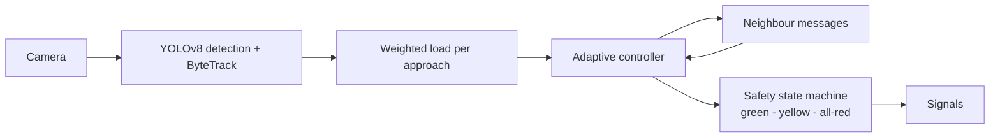

# Traffic Jam System

A camera-based adaptive traffic-signal controller that learns the road it is pointed at, and a network
layer that lets neighbouring signals share what they see. Built to reduce congestion in cities such as
Lusaka, where fixed-time signals cannot react to demand and police direct traffic by hand when power
fails.

> **Status: research prototype.** The control logic is tested in simulation, including SUMO. It has not
> yet been validated on footage of a real junction, and it does not control real signals.

## Result so far

On a simulated four-node corridor at peak demand (SUMO, 3 runs per setting), delay per vehicle was:

| Control | Mean delay | 95th percentile | Busiest road (1.0 = full) |
| --- | ---: | ---: | ---: |
| Fixed-time (30 s greens) | 405 s | 1189 s | 1.27 |
| Stand-alone adaptive | 337 s | 1019 s | 1.28 |
| **Connected adaptive** | **197 s** | **591 s** | **0.62** |

Connected control, where neighbouring junctions share queue and arrival information, cut mean delay by
42% against the same adaptive junctions working alone. Read these numbers with care:

* The traffic is illustrative, not measured on real roads, and the peak setting is deliberately heavy.
  The figures show direction, not what a real city will see.
* The fixed-time baseline is untuned, with no timing offsets.
* One corridor, three random seeds. The grid network and other traffic levels have not been run in SUMO.
* A learned arrival predictor and Google congestion data were tried and showed no consistent extra gain.

## How it works



1. **Detect.** YOLOv8 finds cars, motorcycles, buses, trucks and people. ByteTrack follows them.
2. **Weigh.** Each vehicle adds its passenger-car equivalent: car 1.0, motorcycle 0.4, bus 2.0, truck 2.5.
   Loads are smoothed over about 1.5 s.
3. **Score.** A phase's score is the sum of its approach loads plus 0.1 times the longest wait, so busy
   approaches win but no approach is starved.
4. **Switch safely.** A separate state machine enforces a minimum green, yellow, all-red, a maximum green and a
   starvation limit. The decision logic cannot show a conflicting green.
5. **Connect.** Each junction sends neighbours its queue, the vehicles it is releasing toward them and when
   they will arrive. A bonus favours phases with a platoon arriving, and a penalty discourages feeding a
   full road. Messages only change scores, never the safety rules, and a junction that hears nothing for
   15 s behaves as a stand-alone one.

### Works on any road type

`layout.py` describes a road as arms (compass bearing, lanes, two-way or one-way) and a driving side. It
works out every movement, which ones conflict, which only give way, and the smallest set of signal phases.
Presets: crossroads, T-junction, Y-junction, five-way, road-works shuttle, mid-block pedestrian crossing and
one-way crossing. Roundabouts are not covered. **Calibration is automatic:** `autocalibrate.py` learns the arms, stop
lines, detection zones and driving side from tracked vehicle paths, with nothing to draw by hand.

## Quick start

```bash
python -m venv venv
# Windows: venv\Scripts\activate      Linux/Mac: source venv/bin/activate
pip install -r requirements.txt
```

**Test the signal logic (no video needed)**

```bash
python simulate_controller.py
```

**Run on a video** (a fixed camera looking down on a junction)

```bash
mkdir data                                   # put your video in it, e.g. data/junction.mp4
python autocalibrate.py data/junction.mp4    # learns the junction, writes site.json and site_preview.png
python main.py --video data/junction.mp4 --save demo.mp4
```

Press `q` to quit. Options include `--recalibrate`, `--drive-side left|right`, `--conf`, `--no-display`
and `--log`. Open `site_preview.png` to confirm the zones sit on the approaches.

**Single-junction SUMO simulation** (needs [SUMO](https://sumo.dlr.de))

```bash
pip install -r sim/requirements.txt
cd sim
python build_network.py
python run_sim.py --scenario tidal --controller adaptive --gui
python compare.py
```

**Connected network in SUMO**

```bash
cd network
python test_network.py && python test_sumo_glue.py       # checks, no SUMO needed
python sumo_build.py networks/corridor.json
python sumo_run.py networks/corridor.json --scenario peak --mode coordinated --gui
python sumo_study.py --networks corridor --scenarios peak --seeds 3
```

## Repository layout

| Path | Purpose |
| --- | --- |
| `main.py` | Detection, tracking, zone loads, decisions, live overlay, logging |
| `autocalibrate.py` | Learns the junction from video: arms, stop lines, zones, driving side |
| `layout.py` | Road layouts: movements, conflicts and phases derived by geometry |
| `controller.py` | Adaptive controller and the fixed-time baseline |
| `config.py` | Vehicle weights, timings and decision rules |
| `simulate_controller.py` | Safety and behaviour test on synthetic demand |
| `sim/` | SUMO simulation of a single junction of any type; see `sim/README.md` |
| `network/` | Connected signals: graph, neighbour messages, predictor, simulators; see `network/README.md` |
| `gmaps/` | Offline Google congestion data to rank corridors; not used by the live controller |

## Limitations

* **No real-junction validation yet.** Calibration was tested on synthetic traffic with known truth. The
  first real clip showed traffic in one direction only, so it found no junction. Detection accuracy on
  minibuses and motorcycles is unmeasured.
* **A software prototype.** Controlling real signals needs a hardware conflict monitor, power backup and road-authority
  approval.
* **Simplified signalling.** One signal per approach; no protected turn phases yet. A right turn waiting for
  a gap can hold up straight traffic in its lane.
* **Chosen parameters.** Weights, the 0.1 wait weight and the 1.5 switch ratio are reasonable defaults, not
  tuned on local data.
* **Google data.** `gmaps/fetch_profile.py` has not been run against the live API. The live controller never
  calls Google, because its data update in minutes and its terms limit storage and use.
* The `network/netsim.py` simulator is a simplified model for fast logic checks, not SUMO. Use SUMO numbers
  for results.

## Roadmap

1. Record or obtain footage of a real junction; measure detection accuracy against hand counts.
2. Run the full SUMO study on both networks, with message loss, a tuned fixed-time baseline and a sensitivity
   check on the parameters.
3. Add protected turn phases.
4. Design a pilot at one junction, with a hardware safety controller, backup power and approvals.

## Evidence and sources

Background figures on adaptive signal control (FHWA, the Pittsburgh SURTRAC pilot, Google Project Green
Light) and on Lusaka's congestion and load-shedding are cited in the project report. They show what adaptive
control has achieved elsewhere, not what this system will achieve in Lusaka.

## Licence

MIT. See `LICENSE`.
